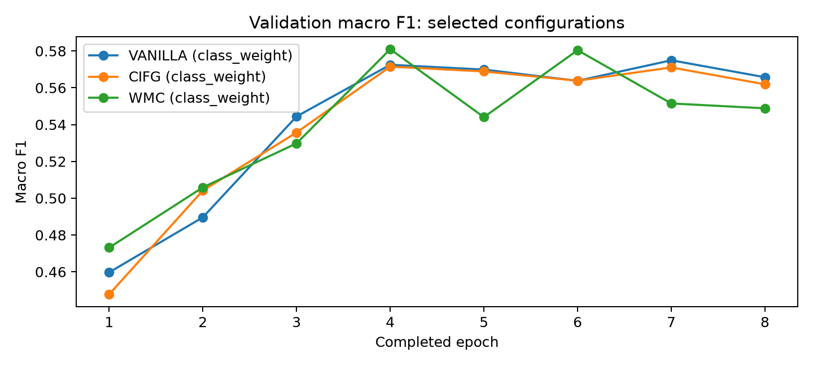
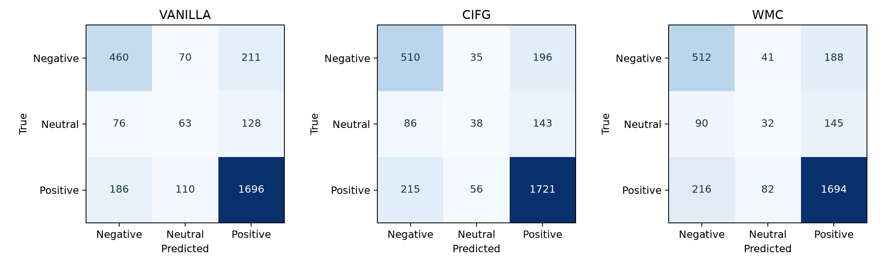

# Drug Review Classification with Vanilla, CIFG and WMC LSTMs

Advanced Natural Language Processing | 2026/2027
24 October 2026

Team members: ZATRI Abderahmane, FAZOUANE Oualid, GUELLIDA Mehdi, HARTI Lina

## 1. Project aim

Our task is to classify English medication reviews as negative, neutral or positive. We chose the Drug Review Dataset (Drugs.com), one of the options in the project guidelines [1]. We compare a vanilla LSTM with two cells from the appendix: Coupled Input-Forget Gate (CIFG) and Working Memory Connections (WMC). We also compare training settings to see whether they matter as much as the cell design.

The ratings provide the labels: 1-4 means negative, 5-6 neutral, and 7-10 positive. We chose these intervals for this project. The model receives only the written review. The rating, drug name, condition, date and useful-vote count are not input features.

## 2. Dataset and preparation

The UCI archive [2] contains 161,297 training reviews and 53,766 test reviews in TSV format. The program reads them using a tab separator. It decodes HTML entities, converts text to lowercase and collapses repeated whitespace. After this normalization, exact duplicates are removed. The first occurrence is kept; training records take priority over identical test records.

The filter removes 48,999 records from the official training source and 37,622 from the test source. We reserve 15% of the cleaned training source for validation, then take stratified subsets with seed 42. This keeps the experiment within our time budget while preserving the class proportions.

| Partition | Reviews | Negative | Neutral | Positive |
| --- | --- | --- | --- | --- |
| Training | 15,000 | 3,718 | 1,335 | 9,947 |
| Validation | 1,500 | 372 | 133 | 995 |
| Test | 3,000 | 741 | 267 | 1,992 |

Positive reviews make up 66.3% of the training subset. The median review length is 97 tokens and the 90th percentile is 162. We therefore report macro F1 alongside accuracy and limit inputs to 160 tokens. The vocabulary contains 18,000 entries, including padding and unknown tokens, and is built from training text only.

---

## 3. Models

All three classifiers use the same structure: a 64-dimensional learned embedding, one recurrent layer with 64 hidden units, masked mean pooling, dropout of 0.2 and a linear output layer with three logits. Mean pooling averages the hidden states over valid tokens. Padding positions are excluded, and padded steps cannot change the recurrent state.

The recurrent cells are written with nn.Linear rather than nn.LSTM. Their equations follow the course appendix [1]. For a gate q, let A_q = W_xq x_t + W_hq h_prev + b_q. Here sigmoid is the logistic function and * denotes elementwise multiplication. The candidate is g = tanh(A_g).

| Cell | Gate equations |
| --- | --- |
| Vanilla | i = sigmoid(A_i); f = sigmoid(A_f); o = sigmoid(A_o) |
| CIFG | f = sigmoid(A_f); i = 1 - f; o = sigmoid(A_o) |
| WMC | i = sigmoid(A_i + tanh(W_ci c_prev)); f = sigmoid(A_f + tanh(W_cf c_prev)); o = sigmoid(A_o + tanh(W_co c_new)) |

For every cell, c_new = f * c_prev + i * g and h_new = o * tanh(c_new). In WMC, the input and forget gates read the previous memory, whereas the output gate reads the updated memory. CIFG removes an independent input gate, which reduces recurrent parameters. WMC adds three full memory-to-gate matrices. The readings listed in the handout are given in [3] and [4].

| Cell | Recurrent parameters | Total trainable parameters |
| --- | --- | --- |
| VANILLA | 33,024 | 1,185,219 |
| CIFG | 24,768 | 1,176,963 |
| WMC | 45,312 | 1,197,507 |

The totals include the embeddings and output layer. Embeddings account for most parameters, so differences in recurrent complexity are less visible in the totals. We keep the hidden size fixed for all cells; the models are not matched to exactly the same parameter count.

Linear weights use Xavier uniform initialization. Biases start at zero except the forget-gate bias, which starts at 1. The embeddings use the PyTorch default initialization. We compute the input affine transform for all timesteps together, then apply the recurrent updates in sequence. This changes the computation order without changing the cell equations.

---

## 4. Training and hyperparameter comparison

We use Adam and cross entropy, with gradient clipping at norm 1.0. Each cell is trained with four settings. Each alternative changes one setting relative to the reference. The weighted loss uses w_k = (N / (3 n_k))^0.5, where n_k is the number of training reviews in class k. Only training labels are used to calculate these weights.

| Setting | Learning rate | Batch size | Class weights |
| --- | --- | --- | --- |
| Reference | 0.003 | 256 | None |
| Learning rate | 0.001 | 256 | None |
| Batch size | 0.003 | 128 | None |
| Weighted loss | 0.003 | 256 | Square-root inverse frequency |

This gives 12 runs in total. To keep the comparison balanced, the program trains every setting for one epoch before starting the next round. It completed 8 rounds on an NVIDIA GeForce RTX 5060 Laptop GPU using PyTorch 2.14.0+cu130. The recorded total time was 37 minutes 49 seconds. A further round was not started because it could exceed the planned 45-minute budget after allowing time for evaluation.

For each run, we keep the epoch with the highest validation macro F1. We then choose one configuration per cell using that same metric. The final architecture is also selected on validation. Test scores are calculated after these choices are fixed. All runs share the same split manifest and seed. A smaller batch gives more updates per epoch, so this is an equal-epoch comparison, not an equal-update comparison.

| Best validation macro F1 | Reference | LR 0.001 | Batch 128 | Weighted loss |
| --- | --- | --- | --- | --- |
| VANILLA | 0.5490 | 0.5096 | 0.5631 | 0.5749 |
| CIFG | 0.5448 | 0.5120 | 0.5604 | 0.5715 |
| WMC | 0.5365 | 0.5004 | 0.5598 | 0.5810 |

The weighted loss gives the best validation macro F1 for each cell. The smaller learning rate gives lower best scores within this budget. Batch 128 improves on the reference for all three cells, but requires more updates. These observations apply to our tested settings; they do not show that one learning rate or weighting method is always preferable.

Figure 1. Validation macro F1 for the configuration selected for each cell. Later epochs do not always improve the score.

---

## 5. Test results

The following scores use the same 3,000 held-out reviews. The majority reference always predicts positive, the most frequent class in training. Accuracy is the proportion of correct predictions. Macro F1 gives the same weight to the F1 score of each class, making errors on the smaller classes more visible.

| Model | Parameters | Best epoch | Val F1 | Test accuracy | Test F1 |
| --- | --- | --- | --- | --- | --- |
| VANILLA | 1,185,219 | 7 | 0.5749 | 73.97% | 0.5727 |
| CIFG | 1,176,963 | 4 | 0.5715 | 75.63% | 0.5662 |
| WMC | 1,197,507 | 4 | 0.5810 | 74.60% | 0.5505 |
| Majority | 0 | - | - | 66.40% | 0.2660 |

CIFG has the highest observed test accuracy, while Vanilla has the highest test macro F1. WMC had the highest validation macro F1 and remains our validation-selected final model. We report the difference in rankings rather than changing the selection rule after looking at the test scores.

| Model | Negative F1 | Neutral F1 | Positive F1 |
| --- | --- | --- | --- |
| VANILLA | 0.629 | 0.247 | 0.842 |
| CIFG | 0.657 | 0.192 | 0.849 |
| WMC | 0.657 | 0.152 | 0.843 |

Figure 2. Test confusion matrices. Rows are true labels; columns are predicted labels. Every matrix contains 3,000 reviews.

Positive reviews are the easiest class for all three models. Neutral reviews are the main weakness. Vanilla correctly identifies 63 of 267 neutral reviews, CIFG 38 and WMC 32. Many neutral reviews are predicted as positive. A middle rating can correspond to mixed language, and the smaller number of neutral training examples may also contribute to these errors.

All three models exceed the majority reference on both metrics. Still, accuracy in the mid-seventies should not hide the low neutral-class recall. The confusion matrices are more informative than a single headline score.

---

## 6. Discussion and limitations

WMC adds memory connections, but the test results do not show a clear advantage over Vanilla or CIFG. CIFG uses fewer recurrent parameters and achieves the highest test accuracy in this run. Vanilla better balances the three class F1 scores. The validation differences are small, and one seed is not enough to conclude that one cell is generally better.

The rating-to-label mapping is another limit. A review may mention serious side effects and still have a high rating, or describe both benefits and problems. Our label comes from the numeric rating rather than a human sentiment annotation. Keeping the first duplicate also retains one label when identical reviews have conflicting ratings. Exact deduplication does not remove paraphrases or guarantee separation by patient or drug.

We used a reduced training set and the first 160 tokens of each review. Longer reviews can lose important information near the end. A larger dataset, several random seeds and a sequence-length comparison would make the conclusions stronger. We would also compare against a TF-IDF linear classifier to check whether the recurrent models justify their added cost. These are proposed follow-ups, not measured results in this report.

## 7. Reproducibility and conclusion

The implementation has five automated tests covering the cell equations and finite gradients, parameter counts, exact-duplicate removal, padding behavior, and equivalence of the vectorized input transform to step-by-step computation. The experiment saves its vocabulary, review hashes, environment, per-epoch results and checkpoints. These files allow the same split and model settings to be inspected without retraining.

We completed the required three-cell comparison within the available training time. The main practical finding is that loss weighting improves validation macro F1 in this setting, while extra cell complexity does not guarantee a better test result. The models are useful for this classification exercise, but their neutral-class errors remain an important weakness.

## References

[1] Course handout. Lab Project on Recurrent Neural Networks, Advanced Natural Language Processing, 2026/2027, pp. 1-2. Guidelines_RNN_2627.pdf.

[2] UCI Machine Learning Repository. Drug Review Dataset (Drugs.com), dataset 462. Description: https://archive.ics.uci.edu/dataset/462 . Archive used: https://archive.ics.uci.edu/ml/machine-learning-databases/00462/drugsCom_raw.zip . The description page returned HTTP 403 when checked; the archive was downloaded from the UCI server.

[3] Greff, K. et al. LSTM: A Search Space Odyssey. IEEE Transactions on Neural Networks and Learning Systems, 2017. https://arxiv.org/abs/1503.04069 . CIFG reading listed in the handout.

[4] WMC reading listed in the course appendix: https://www.sciencedirect.com/science/article/pii/S0893608021003439 . Cell equations in this project follow the supplied appendix.
